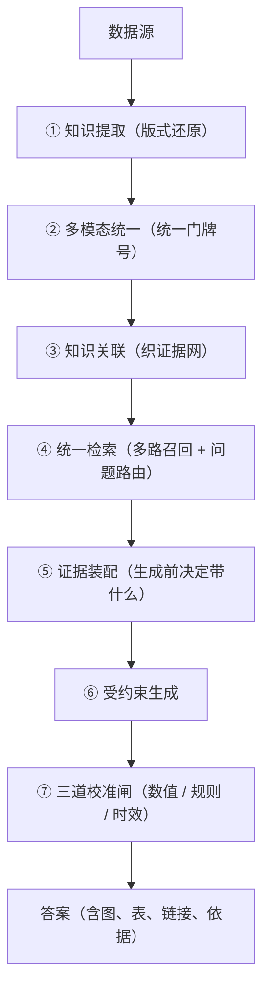

# 一、场景与问题

## 1.1 四种数据

| 数据类型 | 典型内容 | 它擅长回答什么 | 它的坑 |
|---|---|---|---|
| **文档** | Word 制度、手册，夹杂流程插图、现场照片、系统截图 | "规定是什么"、"怎么操作" | 图和文字是**互证**关系，拆开就废 |
| **数字** | 数据库表、Excel 台账、设备时序 | "实际是多少"、"有没有异常" | 数据会变且带口径，**只索引入口、不索引内容**|
| **规则** | 温度上限、电流阈值、金额分档 | "什么条件下做什么" | 差一个字（含不含）结论就反了 |
| **管理规则** | 80 万 / 80–100 万 / 100 万以上三档流程 | "我这种情况走哪条路" | 需要**计算 + 判定**，不是"找相似段落" |

> **说明**："规则"和"管理规则"技术上是一回事（条件→结论），区别只在**域**——前者管工艺参数（温度、电流），后者管管理流程（金额、审批）。所以后文统一按"规则"处理，不重复建两套机制。

## 1.2 五种提问

| 问题类型 | 例子 | 答案长什么样 |
|---|---|---|
| **规则类** | "单一来源采购要满足什么条件" | 结论 + 条款原文 + 文号条款号 |
| **流程类** | "从立项到签约要走几步" | 步骤序列 + 每步责任人 + 材料 + 系统入口 |
| **多模态类** | "这个阀门在图纸哪个位置、现场怎么装" | 结论 + **图上位置** + 照片 + 说明 |
| **对比类** | "公开招标和竞争性谈判有什么区别" | 对比表 + 适用情形 + 转换条件 |
| **混合计算类** | "90 万的项目该谁审批、要交哪些材料" | **算出来的结论** + 依据 + 清单 |

**关键观察**：这五类问题的"正确答案"形态完全不同。规则类要的是条文，流程类要的是路径，多模态类要的是**图和文的对应**，对比类要的是**表格**，混合类要的是**算出来的数**。

**用一套流程去套五种需求，就像用一把螺丝刀去拧所有螺丝。**

## 1.3 案例分析

假设制度原文这样写：

> 第八条 项目金额在 **80 万元以下**的，由部门负责人审批；
> 第九条 项目金额在 **80 万元以上、100 万元以下**的，由分管领导审批；
> 第十条 项目金额在 **100 万元以上**的，由总经理办公会审议。

现在用户问："**90 万的项目谁审批？**"

如果用最朴素的"向量相似度"去检索，会发生什么？

$$
\text{sim}(q, d) = \frac{\langle \mathbf{e}(q),\; \mathbf{e}(d) \rangle}{\|\mathbf{e}(q)\| \cdot \|\mathbf{e}(d)\|}
$$

**这个公式在算什么**：把问题和每段文字各自变成一串数字（向量），然后看两串数字的方向有多接近。$1$ 表示完全一致，$0$ 表示毫不相干。

- 问题 $q$ 含"90 万""审批"
- 第八条 $d_1$ 含"80 万""审批"——和 $q$ 共享"万""审批""项目金额"
- 第九条 $d_2$ 含"80 万""100 万""审批"——共享得更多

**直觉上 $d_2$ 应该得分更高**。但实际情况常常相反，原因有三：

1. **数字不是语义**。模型看到"90 万"和"80 万"时，它们的"语义"几乎一样——都是"一笔钱"。真正区分它们的是**大小关系**，而大小关系不是向量能表达的。
2. **否定和区间最容易被忽略**。"80 万以上"和"80 万以下"在字面上高度重合（五个字里四个一样），向量相似度可以高到 0.95，但结论完全相反。
3. **越详细的段落越容易被召回**。第十条往往写得最短（只有一句），第九条最长（要解释中间档），长段落召回概率更高——**这叫"长度偏置"，是检索系统的通病**。

**所以：规则类问题，检索系统天然做不好。** 不是模型不够强，是这件事本来就不该用"找相似"来解决。

---

# 二、多模态统一（≠塞进同一个向量空间）

很多方案的第一反应是："把所有模态都变成向量，放进一个库，就能统一检索了。"

这个想法很自然，但在工业场景里会失败。原因是**不同模态的"相似"根本不可比**。

## 2.1 做法对比

**错误做法**：把所有书、图片、表格都撕碎、混在一起，装进一个大箱子，然后按"内容像不像"来找。

结果：你问"80 万以上怎么审批"，它翻出一段讲"80 万以下"的文字——因为这两段有 90% 的字是一样的。它还会翻出一张流程图——因为图里也有"审批"两个字。

**正确做法**：编索引卡片。每张卡片写着：

> "这段话出自《项目管理办法》**第九条**，属于**第 3 章 审批权限**，涉及**项目金额**这个对象，**2026 年版**有效。"

图和表也各有一张卡片，指向**同一个位置**。

这样，你问"第九条讲了什么"，能同时调出**条文、配套流程图、系统截图、以及台账里引用第九条的项目**——它们不是"长得像"，而是"在同一个地址上"。

## 2.2 核心原则

统一知识寻址方式：

$$
\kappa(e) \;=\; \big(\;\text{文档},\; \text{版本},\; \text{章节},\; \text{步骤号},\; \text{实体},\; \text{生效时间}\;\big)
$$

**这个公式在算什么**：给每一条知识 $e$ 发一个"地址" $\kappa(e)$，由六个坐标组成。任何模态（一段文字、一张图、一个表格单元格、一条测点数据）都挂在这个地址上。

**为什么这件事关键**：

| 如果统一"长相"（同一个向量空间） | 如果统一"门牌号"（同一个地址体系） |
|---|---|
| 图和文本被迫压到同一维度，细节丢失 | 图保留图的细节，文字保留文字的精确 |
| 相似度跨模态不可比 | 同地址的证据天然可比（它们是同一件事的不同侧面） |
| 换模型就要全量重建 | 换模型只影响检索层，地址不变 |
| 无法回答"这段话的依据在哪一页哪一条" | 每个证据都能回到原文位置 |

**一句话**：我们要统一的不是"表示形式"，而是"**寻址方式**"。

## 2.3 统一的三个层次

| 层次 | 统一什么 | 怎么做 | 不做什么 |
|---|---|---|---|
| **L1 地址统一** | 定位 | 文档 ID + 版本 + 章节 + 步骤 + 实体 + 时间 | 不做语义压缩 |
| **L2 语义统一** | 可被检索 | 图像→结构化描述；表格→表头+类型；时序→句柄 | 不强行对齐到同一向量空间 |
| **L3 证据统一** | 可被引用 | 统一成"证据单元"这个抽象 | 不合并不同模态的内容 |

**L1 是地基**。没有地址，后面的关联、引用、版本管理全都做不了。

---

# 三、知识库构建的主要步骤



## 工序 ① 知识提取

**工序目标**：不是"把文件读成文字"，而是"**把文件的层次结构读出来**"。

这一道工序决定后面所有事情的上限。因为工业文档的信息密度，**大部分藏在结构里**：

| 结构信息 | 丢了会怎样 |
|---|---|
| 章节层级（1.1 / 1.1.1） | 检索到一段话，不知道它属于哪一章，无法判断适用范围 |
| 条款编号（第八条） | 无法精确引用，也无法建立"条款之间引用"的关系 |
| 表格的表头与合并单元格 | 读到一堆数字，不知道哪个是"金额"哪个是"时限" |
| 图与上下文的绑定 | 图和说明文字分离，图变成孤立的图片 |
| 页眉页脚/水印 | 版本信息丢失（"2024 版"和"2026 版"混在一起） |

**三个必须做对的动作**：

1. **条款不切开**。一条制度如果包含"条件 + 结论 + 例外"，必须整条保留。切开后，"除……外"这种例外会变成孤立的句子，语义完全相反。
   
   > 举例："除经总经理批准外，金额超过 80 万元的项目应由分管领导审批。" 如果切成两段，"金额超过 80 万元的项目应由分管领导审批"就会成为一条**没有例外**的硬规则——这是最危险的错误。

2. **表格转成"带表头的结构"**，不是转成文字。表格的价值在于"行列对齐"，转成"金额 90 万 时限 5 天"这样的流水文字就废了。

3. **图必须绑定上下文**。一张流程图，要知道它是"第 3 章第 2 节 立项流程"配的图，而不是"某张图"。

## 工序 ② 多模态统一

这是最容易做错的一步。很多方案统一把图交给视觉模型"看图说话"，生成一段描述塞进向量库。**这对流程图是灾难**。

因为视觉模型看到流程图，通常会说："这是一张流程图，包含了若干步骤和判断节点，说明了业务流程。"——**信息量为零**。

**正确的做法是分类处理**：

| 图类型 | 例子 | 该怎么处理 | 产出什么 |
|---|---|---|---|
| **流程图** | 立项审批流程、设备操作流程 | **转成有向图**：识别节点、判断分支、箭头方向 | 节点表 + 边表（谁指向谁） |
| **现场照片** | 设备安装、阀门位置、管线走向 | **部件标注**：识别关键部件并给出区域坐标 | 部件名 + 图上位置 + 关联设备 |
| **系统截图** | 采购系统页面、字段填写界面 | **界面解析**：页面名 + 控件 + 字段 | "点哪个页面的哪个字段" |

**为什么流程图必须转成图（而不是描述）**

因为流程类问题的本质是"**路径查询**"：

$$
\text{Path}(s \to t) \;=\; \{\, p \;\mid\; p \text{ 是从节点 } s \text{ 到节点 } t \text{ 的一条合法路径} \,\}
$$

**这个公式在说什么**：用户问"从立项到签约怎么走"，答案不是"一段描述",而是从图里找出**所有合法路径**，每条路径上标着每步的责任人、材料、系统入口。

**只有把流程图变成真正的图（节点 + 边），才可能算出路径**。一段文字描述是算不出路径的。

**数字类数据：索引"入口"，不索引"内容"**

这是另一个关键原则。数据库表、Excel 台账、设备时序——**不应该把内容搬进向量库**。

理由：
- 数据会变（今天 90 万，明天可能改成 95 万），静态索引必然过期；
- 数据量大（设备时序每秒一条），搬进向量库既浪费又无用；
- 数据有精度（金额差 1 元就是不同档），向量化会丢精度。

**正确的做法：索引"怎么查"，不索引"查到的结果"**。

$$
\mathcal{I}(D) \;=\; \big\{\,(\text{表名},\; \text{字段},\; \text{单位},\; \text{采集频率},\; \text{正常范围},\; \text{归属设备})\,\big\}
$$

**这个公式在说什么**：对每份数据源，只索引它的"说明书"——这个表叫什么、有哪些字段、单位是什么、多久更新一次、正常范围多少。真正取数时，用工具去查。

**打个比方**：图书馆不会把每本书的内容抄在索引卡上，只写"书名、作者、索书号"。要看书，按索书号去架上取。

## 工序 ③ 知识关联

**工序目标**：让"制度条款"和"图上步骤"和"台账数据"之间能互相找到。

**四种必须建立的关联**：

| 关联类型 | 例子 | 怎么建 |
|---|---|---|
| **引用关系** | 第九条引用了第三条 | 从文本里提取"依照第X条" |
| **版本替代** | 2026 版替代 2024 版 | 从文件的"实施日期/替代说明"提取 |
| **制度↔流程** | 第九条对应流程图的"分管领导审批"节点 | 人工确认（半自动） |
| **制度↔数据** | 台账的"项目金额"字段对应第九条的"项目金额" | 字段映射表 |

**这里必须诚实说一句**：第三、四类关联**做不到全自动**。制度语言和流程图语言的差异太大，纯算法匹配的准确率通常不到 60%。**需要人工核验**，而且这是项目工作量的主要来源之一（几百到上千个节点，人月级）。

**方案里如果写"自动构建知识图谱"，是不诚恳的**——要么低估了工作量，要么会交付一个看起来完整但实际错漏很多的图。

**每条关联必须带三样东西**：

1. **来源位置**（条款号 / 图的节点 ID / 表字段名）
2. **确认状态**（机器抽取 / 人工确认）
3. **置信度或备注**

没有这三样，图谱就是一张"看起来很厉害但不敢用"的图。

## 工序 ④ 统一检索

**这一道工序是全文的枢纽**。核心思想：

> **不是用一个检索器回答所有问题，而是先判断"这是什么问题"，再决定"去哪里找"。**

**四路召回**（并行执行）：

| 召回通道 | 找什么 | 适用问题 |
|---|---|---|
| **全文检索**（关键词） | 精确词、编号、条款号 | "第九条"、"GB/T 12345" |
| **语义检索**（向量） | 意思相近的段落 | "怎么办手续"→"办理流程" |
| **结构化查询**（图/表） | 流程路径、规则区间 | "从立项到签约"、"90 万走哪档" |
| **工具取数**（SQL/接口） | 实际数值、台账、时序 | "上个月采购总额"、"3 号线温度" |

**合并去重靠"地址"，不靠"分数"**：

$$
\text{Evidence}(q) \;=\; \bigcup_{m \in M} \text{TopK}_m(q), \qquad \text{去重依据} = \kappa(e)
$$

**这个公式在说什么**：从四个通道各取前 K 条，然后**按门牌号去重**——同一个地址（同一条款的文字、图、表）只保留一份。这样不同通道的"分数"不需要可比，因为合并依据是地址不是分数。

**为什么这一点很重要**：如果按分数合并，就要解决"全文检索的分数"和"向量的相似度"如何换算——这是一个没有标准答案的问题，很多系统在这里埋了隐性 bug。

## 工序 ⑤ 证据装配

**这是对你原方案第 (f) 项的一个修正建议。**

原方案是"生成后再做多模态补全"。但实践中这样做，补上去的图往往是**装饰性的**（"顺便放张流程图"），不是**证据性的**（"这一步的依据是图里的这个节点"）。

**更好的做法：把"带哪些证据"提前到生成之前决定。**

$$
\text{生成} \;=\; \text{文字} \;\oplus\; \text{锚点}(\kappa_1, \kappa_2, \ldots, \kappa_n)
$$

**这个公式在说什么**：生成的答案由"文字"和"若干个锚点"组成。锚点指向证据（某条款、某图的某节点、某表某行）。生成时只决定"这里要引用第几条"，具体内容由系统按锚点去取。

**这样做有三个好处**：

1. **图和文天然对齐**：因为锚点在生成前就定了，不会出现"文字讲 A 步骤、配图是 B 步骤"；
2. **可校验**：每个锚点都能检查"这个位置真的存在吗"；
3. **可替换**：图更新了，答案不变，只是锚点取到新图。

**装配时按问题类型决定证据组合**：

| 问题类型 | 必带证据 | 可选证据 |
|---|---|---|
| 规则类 | 条款原文 + 文号 + 条款号 | 修订说明 |
| 流程类 | 节点序列 + 每步责任人 + 材料 | 流程图 + 系统截图 |
| 多模态类 | **图的区域坐标 + 对应说明文字** | 现场照片 |
| 对比类 | 对比表 + 各自依据 | 适用情形说明 |
| 混合计算类 | **计算过程 + 规则判定 + 数据来源** | 敏感性说明 |

## 工序 ⑥ 受约束生成

**这是全文第二重要的原则。**

大模型最不可靠的地方是**算数**。它会把 90 万算成"超过 100 万"，会把三个月的时限算成"90 天"。这不是模型不聪明，是它本来就不是计算器。

**正确做法：把答案的生产拆成四层，每层职责单一**：

$$
\text{答案} \;=\; \text{表述}\Big(\; \text{判定}\big(\; \text{计算}(\; \text{取数}(\; \text{检索证据} \;)\; )\; \big)\; \Big)
$$

**这个公式在说什么**：从里往外读——

| 层 | 谁来做 | 输出 | 能不能错 |
|---|---|---|---|
| **检索证据** | 工序 ④ | 相关条款、图、表 | 可能漏，但可查 |
| **取数** | SQL / 接口 | 精确数值 | **必须零错** |
| **计算** | 公式 / 代码 | 算出来的结果（落在哪一档） | **必须零错** |
| **判定** | 规则引擎 | 该走哪个流程 | **必须零错** |
| **表述** | 大模型 | 人话 | 可能措辞不当，但数字已被锁定 |

**大模型只负责最外层**。前三层都是确定性程序。这样即使模型措辞不好，**结论和数字是对的**。

**具体到"90 万谁审批"这个例子**：

```
① 检索：找到第八、九、十条（三条都要，不能只找一条）
② 取数：从用户问题/台账取到 amount = 900,000 元
③ 计算：判定落在哪个区间 → [800000, 1000000) → 第九条
④ 判定：第九条 → 审批人 = 分管领导；材料 = 3 项
⑤ 表述："90 万元属于 80 万至 100 万元档，依《项目管理办法》第九条，由分管领导审批。需提交……"
```

**关键：如果第①步只召回了第九条，第③步就无法验证"90 万真的落在第九条"**——因为缺少第八条和第十条作为边界对照。

**这是一个实践要点**：规则类检索必须**召回相邻档位**，用来做边界校验。只召回"最像的那一条"是不够的。

## 工序 ⑦ 结果校准

**这是对你原方案 (g)"实时校准"的具体化。**"校准"是个模糊词——校准什么？我的建议是明确成**三道闸**，每次生成后依次过一遍。

**闸一：数值校准——所有数字必须可追溯**

$$
\text{合法}(a) \;=\; \forall\, n \in \text{数字}(a):\; n \in \text{来源}(e_1, \ldots, e_k)
$$

**这个公式在说什么**：答案 $a$ 里出现的**每一个数字** $n$，都必须能在引用的证据里找到出处。找不到就是**编造**，必须拦下。

**这是工业场景最刚性的要求**。因为一个错误的金额、一个错误的温度上限，可能导致真实的业务事故。

**实操**：把答案里的所有数字抽出来（正则 + 模型），逐个回查证据文本。命中率必须 100%，否则退回重生成。

**闸二：规则校准——条件不全就不许下结论**

$$
\text{可判定}(q) \;=\; \bigwedge_{c \,\in\, \text{必要条件}(q)} \text{已知}(c)
$$

**这个公式在说什么**：一个问题要能回答，它的**所有必要条件**都必须已知。任何一个未知，就不能给结论。

**以 90 万为例**，必要条件至少包括：金额、项目类型（工程/货物/服务）、资金性质、所属单位。**如果用户只说了金额，系统应该说"还需要知道项目类型"，而不是直接给出审批人。**

**这是"追问"的理论依据**——不是系统笨，是条件真的不够。

**闸三：时效校准——引用的制度必须是现行有效的**

$$
\text{有效}(e, t) \;=\; \big(\text{实施日期}(e) \le t\big) \;\wedge\; \big(t < \text{失效日期}(e)\big)
$$

**这个公式在说什么**：一条制度在时间 $t$ 有效，当且仅当它已开始实施、且尚未失效。

**为什么必须做**：制度改版很频繁。如果 2026 版替代了 2024 版，而系统同时索引了这两版，检索可能召回旧版——**答案看起来完全正确，但依据已经作废**。这是最隐蔽的错误，因为它不会被任何"准确性检查"发现。

**实操**：每个条款带 `[生效日, 失效日)` 区间，检索时按当前时间过滤。旧版保留但标记为"历史版本"，只在用户明确问"以前怎么规定的"时才召回。

---

# 四、针对五类提问的执行路径

有了上面的七道工序，下面回答"怎么处理五类不同问题"。

**核心思想：七道工序是"公共设施"，五条路径是"不同的走法"。** 不是五个系统，是一个系统里的五种调度。

## 路径 A：规则类问题

**典型问法**："单一来源采购需要什么条件？""90 万谁审批？"

**走法**：

```
识别规则要素（金额/类型/单位） 
  → 检索相邻档位条款（不止一条）
  → 取数（若涉及具体数值）
  → 规则引擎判定区间
  → 输出：结论 + 条款原文 + 文号条款号 + 适用条件
```

**三个设计要点**：

1. **必须召回"边界邻居"**。问第九条，要同时召回第八、十条，用来校验边界。
2. **区间用半开区间表示**，避免重复和遗漏：

$$
\text{命中}(x) \;=\; \{\, i \;\mid\; l_i \le x < u_i \,\}
$$

**这个公式在说什么**：每一个档位 $i$ 用"左闭右开"区间 $[l_i, u_i)$ 表示。80 万整落在"80 万以上"这一档，100 万整落在"100 万以上"这一档，**不重不漏**。

3. **边界必须显式定义**。"80 万以上"到底含不含 80 万？制度原文常常说不清。**这时必须标注"边界待确认"**，而不是猜一个。

## 路径 B：流程类问题

**典型问法**："从立项到签约要走几步？""这个环节谁审批？"

**走法**：

```
识别起点和终点（或"当前所在节点"）
  → 图查询（找路径）
  → 补充每节点的责任人、材料、系统入口
  → 输出：节点序列 + 每步四要素 + 流程图锚点
```

**三个设计要点**：

1. **流程必须是图，不是段落**。段落无法回答"如果条件不满足会退回哪一步"。
2. **双轨要分开**。行业流程和公司流程可能 80% 相同，但**关键节点不同**。必须维护两套图，并且在答案里明确"你现在走的是哪一套"。
3. **要支持"当前位置"查询**。用户往往不是问"全流程"，而是"我在第 3 步，下一步做什么"。这时需要的是**后继节点**，不是整条路径。

## 路径 C：多模态类问题

**典型问法**："这个阀门在图纸哪个位置？""系统里这个字段在哪填？"

**走法**：

```
定位实体（部件名/字段名）
  → 在图像索引里查（部件标注 / 界面元素）
  → 返回：区域坐标 + 该区域对应的说明文字 + 原图锚点
  → 输出：文字说明 + 高亮区域图
```

**三个设计要点**：

1. **图上位置要能返回坐标**，不能只说"在图纸上"。用户要的是**能高亮的区域**。
2. **图和文必须成对返回**。只给图，用户不知道看什么；只给文字，用户找不到位置。
3. **系统截图要能定位到"页面 + 控件"**，这样答案才是"点开 A 页面的 B 字段"，而不是"在系统里填一下"。

## 路径 D：对比类问题

**典型问法**："公开招标和竞争性谈判有什么区别？""2024 版和 2026 版有什么变化？"

**走法**：

```
拆解两个对比对象
  → 并行召回（两个对象各自检索）
  → 抽取"对比维度"（金额门槛/审批层级/所需材料/时限）
  → 按维度对齐
  → 输出：对比表 + 各自依据
```

**核心公式**：

$$
\text{差异}(A, B) \;=\; \{\, (k,\; v_A(k),\; v_B(k)) \;\mid\; v_A(k) \neq v_B(k) \,\}
$$

**这个公式在说什么**：对每个维度 $k$，取出 A 和 B 的取值；**只保留不一样的**。相同的不用列——用户要看的就是差别。

**三个设计要点**：

1. **对比维度必须先定**。不定维度直接让模型"对比一下"，会得到一堆散乱的句子。
2. **两个对象必须用同一套维度取数**，否则表格会残缺。
3. **必须分开"依据"**。表格里每一行的差异，都要能点回各自的条款——不能给一个"混合依据"。

## 路径 E：混合计算类问题

**典型问法**："这个 90 万的项目要交哪些材料？""上个月超过 80 万的项目有几个，都要补什么手续？"

**走法**：

```
拆解成子任务（取数 / 判定 / 检索）
  → 依次执行，每步输出可校验
  → 汇总成结构化结果
  → 表述成自然语言
  → 三道校准闸
```

**举个完整的例子**：

> 用户问："上个月超过 80 万的项目有几个？都要补什么手续？"

| 步骤 | 做什么 | 谁做 | 输出 |
|---|---|---|---|
| 1 | 查台账：上月金额 > 80 万的记录 | SQL | 4 条记录，金额列表 |
| 2 | 逐条判定落在哪一档 | 规则引擎 | 3 条在 80–100 万档，1 条 > 100 万 |
| 3 | 检索两档各自的手续要求 | 检索 | 两套材料清单 |
| 4 | 求并集/分别列出 | 代码 | 清单 |
| 5 | 表述 | 大模型 | 自然语言 + 计算过程 |

**关键**：**第 1、2 步绝不能由大模型做**。让模型"数一下有几个"是最危险的操作——它可能数错，而且错得很自信。

## 五条路径的调度表

| 判断依据 | 走向 | 核心引擎 |
|---|---|---|
| 问"能不能/该不该/是否允许" | 路径 A（规则） | 规则引擎 |
| 问"几步/顺序/下一步" | 路径 B（流程） | 图查询 |
| 问"在哪/长什么样/怎么操作" | 路径 C（多模态） | 图像索引 |
| 问"区别/对比/变化" | 路径 D（对比） | 并行召回 + 对齐 |
| 问"多少/几个/合计" | 路径 E（计算） | SQL + 规则 |
| 同时涉及多个 | **组合路径** | 按子任务拆解 |

**现实中大部分问题都是组合的**。比如"90 万谁审批、要交什么材料"= 路径 A + 路径 E。所以**路由不是五选一，而是"拆解成子任务，每个子任务各自路由"**。

---

# 五、四个最容易被忽略、但决定成败的细节

## 5.1 边界：80 万含不含？

这是工业规则场景里**最高频的错误来源**。

制度原文写"80 万元以上"，到底是 $x > 80$ 还是 $x \ge 80$？中文表述在这里是不严谨的。

**处理原则**：

1. **默认采用"左闭右开"**（$[80, 100)$），并在答案里显式写出："90 万元（80 万元 ≤ 金额 < 100 万元）"；
2. **边界值单独标注**。如果原文没说清 80 万整算哪档，答案里要写"80 万元整的归属需与制度起草部门确认"；
3. **不要猜**。猜错的代价是真实的审批错误。

## 5.2 版本：旧答案看起来对，但依据已经作废

这是最隐蔽的错误。系统同时索引了 2024 版和 2026 版，检索召回旧版，**答案的文字完全正确，但依据已经失效**。

**处理原则**：

1. 每个条款带生效区间 $[\text{实施日}, \text{失效日})$；
2. 检索时默认只查"当前有效"；
3. 旧版标记为"历史版本"，只在用户明确问"以前怎么规定"时召回；
4. **答案里必须显示版本号**——"依《项目管理办法》（2026 版）第九条"。

## 5.3 拒答与追问：宁可问一句，不要猜一个

$$
\text{可判定}(q) \;=\; \bigwedge_{c \in C(q)} \text{已知}(c)
$$

**这个公式在说什么**：$C(q)$ 是回答问题 $q$ 的**必要条件集合**，只有全部已知，才可判定。这与工序⑦"闸二"是同一个判据——**闸二负责在生成后拦住它，这里负责在生成前就问出来**。

**必要条件因问题类型而异**：

| 问题类型 | 必要条件 |
|---|---|
| 限额判定 | 金额、项目类型、资金性质、所属单位 |
| 流程导航 | 业务阶段、所在平台（行业 / 公司） |
| 材料清单 | 采购方式、项目类型 |
| 风险识别 | 业务环节、具体情形 |

**缺一个就问，不要给一个"通用答案"**。因为通用答案在具体场景下往往是错的。

**追问要问得让用户答得出**。不要问"你在哪个平台"，而要问"你现在是要报采购计划，还是要发招标公告"——用户可能不知道自己"在哪个平台"，但知道自己"在干什么"。

## 5.4 图不是装饰：锚点必须能被验证

如果答案里放了图，**这张图必须能被验证是"这一处"的证据**。

判定标准：把图里的锚点（某节点 ID、某区域坐标）拿去查，应该能查到**对应的说明文字**。查不到，说明图和文没对齐，这张图就是装饰。

**这条在验收时特别有用**：随机抽 20 条带图的答案，逐个检查"图的锚点能不能对上文字"，命中率低于 90% 就说明多模态关联没做好。

---

# 六、常见问题与解决方案

上面的七道工序和五条路径，解决的是"**制度 + 图纸 + 台账**"这个核心组合。但如果把同样的方法搬到相邻场景——能源电力的操作规程、化工的安全管理、医疗的设备维护、制造工艺的作业指导——会发现还有六件事是这个场景里没有充分覆盖的。

**这一节是给方案做完整性检查用的**：如果你的场景里出现了下面任何一条，就得在七道工序里补上对应环节。

## 6.1 规则冲突问题

**为什么必须有**：工业制度几乎都是多层叠加的——国家法规、行业规定、公司标准、部门细则。你问一个问题，可能同时命中四条规定，而且它们**互相不一致**。

**三类冲突，各有不同的解法**：

| 冲突类型 | 例子 | 谁优先 |
|---|---|---|
| **层级冲突**（上位 vs 下位） | 国家规定"必须公开招标"，公司细则说"可直接委托" | **上位法优先**；下位法与之冲突的部分**无效** |
| **专指冲突**（一般 vs 特别） | 通用办法说"80 万以上招标"，专项规定说"科研设备另有规定" | **特别规定优先**（同一层级内） |
| **时间冲突**（新 vs 旧） | 2024 版与 2026 版对同一条规定不同 | **新法优先**（后法优于前法） |

**消解规则可以写成一条排序函数**：

$$
e^{*}(x) \;=\; \operatorname*{lexmax}_{e \,\in\, E(x)} \Big( \underbrace{\text{层级}(e)}_{\text{法规} > \text{行业} > \text{公司}},\;\; \underbrace{\text{专指度}(e)}_{\text{专项} > \text{通用}},\;\; \underbrace{\text{生效日}(e)}_{\text{新} > \text{旧}} \Big)
$$

**这个公式在说什么**：对同时命中的若干条规定 $E(x)$，按"层级 → 专指度 → 生效日"的**先后顺序**比较，先比第一项，第一项相同再比第二项，以此类推（这叫"字典序"，$\operatorname*{lexmax}$ 就是按这个顺序取最大）。最终选出应该适用的那一条 $e^{*}$。

**三个工程要点**：

1. **冲突不是"两个都答"**。很多系统怕答错，就把两条都列出来让用户自己判断——这在合规场景是**失职**。系统必须给出"以哪条为准"，并说明为什么。
2. **冲突必须显式检测**。检索到多条后，要判断它们是不是在讲**同一件事**（同一实体 + 同一动作 + 同一条件），是的话才可能冲突。不同事的条款并列，不叫冲突。
3. **"下位法更严"是常见且合法的，而且有两种形态**。这时不构成冲突，答案应说明"公司标准更严，按公司标准执行"：
   - **扩面**：适用条件更宽。国家规定 80 万元以上须招标，公司内控要求 50 万元以上就走招标，50–80 万这一段属于**加严**；
   - **提标**：适用条件相同，但要求更高。同样都要招标，公司还要求纪委备案。

$$
\text{加严}(e_{\text{下}}, e_{\text{上}}) \;=\; \big[\, \text{条件}(e_{\text{下}}) \supseteq \text{条件}(e_{\text{上}}) \,\big] \;\wedge\; \big[\, \text{要求}(e_{\text{下}}) \succeq \text{要求}(e_{\text{上}}) \,\big]
$$

**这个公式在说什么**：下位法的**适用条件覆盖了上位法**（$\supseteq$，管得更多），且**要求不低于上位法**（$\succeq$，管得不松），就是合法加严。"提标"形态则是条件相同、要求更严，$\supseteq$ 取等号即可，同一式子覆盖。

**注意这只是必要条件**：要能判出加严，$E(x)$ 里必须有**结构化的条件与要求字段**，纯文本比不出来——这也反过来要求工序①在解析时就把"适用条件"抽成字段，而不是只存原文段落。

## 6.2 计算口径问题

**这是最容易被忽略、但一定会出事的一条。**

同样一个合同，可能算出四个不同的金额：

| 口径 | 取值 | 差异来源 |
|---|---|---|
| **含税 / 不含税** | 90 万 / 79.6 万 | 增值税 13% |
| **单次 / 年度累计** | 90 万 / 240 万 | 同一供应商多次采购 |
| **合同额 / 预算额** | 90 万 / 100 万 | 预算通常含不可预见费 |
| **本币 / 外币** | 90 万 / 12.5 万美元 | 汇率与时点 |

**只要口径错一个，落档就可能错一档，审批人就全错。**

**处理原则**：判定用的金额不是"取到的数"，而是"**按规则口径换算后的数**"：

$$
a_{\text{判定}} \;=\; \Phi\big(\, a_{\text{原始}},\; \text{口径规则} \,\big)
$$

**这个公式在说什么**：$a_{\text{原始}}$ 是台账里那一列的值，$\Phi$ 是按"这条规则要求的口径"做的换算。**同一条规则永远用同一个口径**，不允许这次用含税、下次用不含税。

**必须做的三件事**：

1. **规则侧标注口径**。在规则库里，金额阈值必须带 `tax_included: true/false`、`aggregation: single/cumulative` 这样的字段。**没有标注的规则，默认不能自动判定**。
2. **数据侧标注口径**。台账的"金额"字段是什么口径，要在元数据里写清——这跟工序②"索引说明书"是同一件事。
3. **口径不一致时必须显式提示**。如果规则要求不含税、数据是含税，答案要写："规则按不含税口径（80 万元），本条合同含税 90 万元，折不含税 79.6 万元，落在 80 万元以下档"。**把换算过程写出来**，比直接给结论可靠得多。

## 6.3 权限问题

**为什么必须有**：制度可以全员共享，但**具体实施记录、供应商报价、历史案例、审计问题**往往分级可见。如果系统把"某供应商被处罚"的案例和制度条款关联起来，通过关联把案例内容"顺带"显示给无权用户，就是泄密。

**核心原则：检索前过滤，不是检索后过滤。**

$$
\text{检索}(q, u) \;\subseteq\; \text{可见}(u) \;=\; \{\, e \;\mid\; \text{perm}(u, e) = 1 \,\}
$$

**这个公式在说什么**：用户 $u$ 能检索到的结果集合，必须是"他有权看的那些知识 $e$"的**子集**。也就是说，无权的内容根本不进入候选池，而不是"检出来再删掉"。

**为什么"检出来再删"不行**：因为模型已经"看到"了这些内容（哪怕最后不输出），而日志、缓存、上下文里可能已经留下痕迹。合规审计时这是硬伤。

**两道关卡都要设**：

| 关卡 | 检查什么 | 漏了会怎样 |
|---|---|---|
| **检索前过滤** | 这个用户能查哪些文档/条款 | 结果里出现无权内容 |
| **关联扩展二次校验** | 顺着图谱跳过去的节点，用户有权看吗 | 通过关联"绕道"看到无权内容 |

**第二道最容易被漏掉**。比如：制度（公开）→ 引用 → 案例（受限）。检索命中制度，图谱扩展时跳到案例，如果扩展不看权限，就绕过了第一道关。

## 6.4 术语与位号问题

**为什么必须有**：工业现场的实体命名极度混乱——

| 同一台设备，可能被叫作 |
|---|
| 位号：`P-101A`（P&ID 图上的编号） |
| 资产号：`EQ-2023-0451`（资产系统） |
| 中文全称：`一号进料泵` |
| 口语简称：`一号泵`（现场） |
| 英文名：`Feed Pump No.1` |

**用户问"一号泵怎么保养"，系统必须知道这就是 `P-101A`**，否则查不到保养规程，也关联不到 P&ID 图上的位置。

**解法：建一张实体别名表，作为检索的"翻译层"**

$$
\text{归一}(s) \;=\; \text{CanonicalID}, \qquad s \in \{\text{位号},\ \text{资产号},\ \text{全称},\ \text{简称},\ \text{英文}\}
$$

**这个公式在说什么**：把任何一个写法 $s$，都映射到一个唯一的规范 ID。检索时先把用户说法归一，再用规范 ID 去查。

**三个实操要点**：

1. **位号是主键**。P&ID 位号在工程上最稳定，应作为规范 ID；口语简称做别名。
2. **别名表要能长**。用户会不断发明新叫法（"那个大泵"），要支持人工补充。
3. **归一失败要提示，不要硬猜**。"一号泵"如果对应两台设备，必须追问，不能猜一台。

## 6.5 多轮对话问题

**为什么必须有**：真实使用中，问题是被"问出来"的，不是"一次说完"的。

```
用户：90 万的项目怎么审批？
系统：属于 80–100 万档，由分管领导审批。需要的话我可以列出所需材料。
用户：要交什么？          ← "要交什么"里没有主语，需要承接上文
系统：（继续答材料清单）
```

**三个需要处理的问题**：

| 问题 | 例子 | 处理方式 |
|---|---|---|
| **省略** | "要交什么？" | 从上一轮继承"90 万项目 + 审批"这两个槽位 |
| **指代** | "它呢？"、"那这个呢？" | 解析"它"指向上一轮的哪个实体 |
| **改口** | "不对，是 120 万" | **只更新这一个槽位，其余保留**，重新判定 |

**实现上最简的做法：维护一个"槽位表"**

$$
\text{State}_t \;=\; \text{State}_{t-1} \;\cup\; \Delta_t
$$

**这个公式在说什么**：第 $t$ 轮的对话状态 = 上一轮状态，叠加本轮新信息 $\Delta_t$。$\Delta_t$ 可能只是改一个金额，其余条件沿用。

**一个必须注意的坑**：**改口后必须重新判定，而不是"在旧答案上打补丁"**。用户从 90 万改成 120 万，档位从"80–100 万"跳到"100 万以上"，审批人、材料清单、流程全都变了。如果只是把答案里的数字替换掉，会得到一个"数字对了但结论错了"的答案——这比不答更危险。

## 6.6 增量更新问题

**为什么必须有**：制度是活的。改一条条款，会连带动摇：

```
条款修改
  ├─→ 依赖它的规则（金额阈值变了）
  ├─→ 依赖它的关联（制度↔流程节点、制度↔台账字段）
  ├─→ 依赖它的答案（历史问答里引用这一条的，全部失效）
  ├─→ 依赖它的测试题（回归验证要重跑）
  └─→ 依赖它的别名/术语（新表述进入别名表）
```

**如果只做"新文档入库"，会得到什么**：新旧两版同时在库里，检索随机命中，**答案时对时错**——而且错的时候看起来完全正确（见 5.2）。

**正确的做法：变更影响域分析**

$$
\text{影响}(e) \;=\; \{\, x \;\mid\; x \text{ 依赖 } e \,\}, \qquad \text{重算}(\text{影响}(e))
$$

**这个公式在说什么**：先算出一条条款 $e$ 被哪些东西依赖（规则、关联、问答、测试题），然后只重算这些。

**三个必要机制**：

1. **依赖登记**。每条规则、每条关联、每道测试题，都要记下"我依赖哪一条款"。这是设计时就要埋的，事后补不上。
2. **状态切换而非删除**。旧版保留（标"历史版本"），新版标"现行"，通过状态切换生效——而不是删了旧的。
3. **回归测试**。变更后跑一遍受影响的测试题，确认"新规定被正确引用"，且"旧规定不再作为现行结论被引用"。

## 6.7 补充项

| 补充项 | 什么时候必须做 | 关键设计 |
|---|---|---|
| **审计日志** | 有合规/内审要求 | 记录"谁、何时、问什么、命中哪些证据、最终答案"，且**可回放** |
| **兜底与转人工** | 答案会用于决策 | 定义"什么情况必须转人"：置信度低、涉及金额超阈值、跨部门争议 |
| **反向检索** | 现场作业场景 | 用户上传一张照片/扫一个位号，问"这是什么、怎么维护"——需要"以图查规程" |
| **受众适配** | 多角色共用 | 领导要结论与依据，操作工要步骤与图；同一答案两种表述，**但数字必须一致** |

**"审计日志可回放"这一条特别重要**：出了问题（比如审批依据错了），要能还原"当时系统看到了什么、判定了什么"。如果日志只记最终答案，就无法定位是"检索错了"还是"判定错了"。

## 6.8 优先级建议

| 优先级 | 补充项 | 理由 |
|---|---|---|
| **必做** | 6.1 规则冲突 | 制度库的核心正确性，不做则大面积答错 |
| **必做** | 6.2 计算口径 | 直接影响落档，错了就是业务事故 |
| **必做** | 6.5 多轮对话 | 不做则实际使用率极低 |
| **应做** | 6.3 权限 | 有合规要求就必须做，且必须前置过滤 |
| **应做** | 6.6 增量更新 | 制度会改，不做则半年后系统失效 |
| **按需** | 6.4 术语位号 | 设备/现场类场景必做，纯管理类可缓 |
| **按需** | 6.6 四块 | 看合规要求与角色复杂度 |

**一句话**：6.1、6.2、6.5 是"不完整就会出错"，6.3、6.6 是"不做会出事"，6.4、6.7 是"场景决定"。
